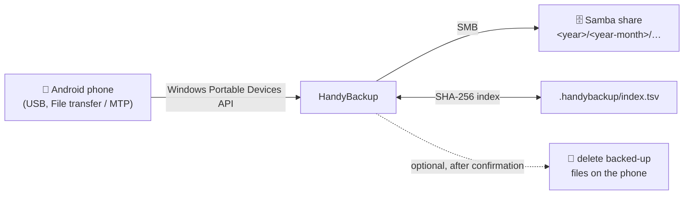

# HandyBackup

**Back up the photos and videos of your family's Android phones to your own Samba server, just by plugging them in via USB.**


HandyBackup is a small desktop application that copies all images and videos from Android phones into a
clean, date-sorted archive on a network share. No cloud, no app on the phone, no USB debugging: the phone
is connected in its normal **"File transfer" (MTP)** mode and HandyBackup does the rest.

Every phone is recognized by its serial number, so each family member's phone always ends up in the
right place, even after switching to a new phone.

---

## Features

- 📱 **No setup on the phone**: works with the standard USB "File transfer" mode. No ADB, no developer options, no app.
- 🗂️ **Tidy archive**: files are stored as `<year>/<year-month>/<original name>`. Camera, screenshots, WhatsApp, Telegram and other sources are all sorted by date.
- 🧬 **Real deduplication**: a SHA-256 index per share means every file is stored only once, even if the same picture comes from the old *and* the new phone.
- ⚡ **Fast incremental runs**: files that were already backed up are recognized by path, size and date and skipped without being transferred again.
- 🔒 **Safe archive**: the backup never overwrites or deletes anything on the share. Name collisions get a `_1`, `_2`, … suffix, and uploads are written to a temporary file and renamed only when complete.
- 🧹 **Free up space on the phone**: optionally delete backed-up files from the phone after the backup. This is configurable per phone: never, everything, or only files older than *x* days (default: 90). A file is only deleted if its copy is verified on the share, and you are always asked first.
- 👀 **Look before you keep**: a double click opens any file from the phone or the share in the system's default application, e.g. the photo viewer.
- 🗑️ **Manual clean-up**: delete selected files on the phone or on the share via the context menu. The confirmation tells you whether the files are backed up, or whether they still exist on the phone.
- 👨‍👩‍👧 **Multi-device, multi-share**: assign any number of phones to any number of shares. Several phones can share one target, e.g. the old and new phone of one person.
- 🔑 **Passwords stay protected**: share passwords are stored encrypted with Windows DPAPI.
- 🌍 **English and German** user interface.
- 🔄 **Built-in update check**.

---

## How it works



1. **Scan**: all image and video files (`jpg`, `jpeg`, `png`, `heic`, `mp4`, `mov`) below the usual media folders are collected: `DCIM`, `Pictures`, `Movies`, `Download`, `Android/media` (WhatsApp, Telegram, Instagram, …).
2. **Skip**: files already in the index for this phone (same path, size and date) are skipped immediately.
3. **Copy and deduplicate**: new files are downloaded and hashed. If the content already exists in the share, only the source is recorded. Otherwise the file is uploaded into its date folder.
4. **Clean up (optional)**: backed-up files that match the phone's deletion setting are verified against the share and, after your confirmation, deleted from the phone.

Not backed up: hidden folders such as thumbnails and trash, WhatsApp `.Statuses`, and WhatsApp's own `Sent` and `Private` folders.

---

## Requirements

| | |
|---|---|
| **Operating system** | Windows (MTP access uses the Windows Portable Devices API) |
| **Java** | Java 17 or newer |
| **Phone** | Android phone connected via USB, unlocked, USB mode set to **"File transfer"** |
| **Backup target** | A Samba/SMB share in your network (user and password) |

---

## Getting started

1. **Start HandyBackup.**
2. **Create a share:** click **Shares …** → **New …** and enter the server, share name, an optional subfolder (e.g. `Phones/Andreas`), user and password. **Test connection** checks the settings right away.
3. **Connect the phone** via USB, unlock it, choose **File transfer** and click **Search devices**.
4. **Assign the phone** to a share under **Backup target**. This is needed only once; the phone is recognized by its serial number from then on.
5. Optionally adjust **Delete from phone after … days**:

   | Value | Effect |
   |---|---|
   | `-1` | never delete anything on the phone |
   | `0` | delete all backed-up files from the phone |
   | `x > 0` | delete backed-up files older than *x* days (default: `90`) |

6. Click **Start backup**.

The main window shows the phone on the left (folders that are backed up are **bold**) and the share on the right.
The log at the bottom lists every step.

---

## Storage layout on the share

```
\\server\share\<subfolder>\
├── 2025\
│   ├── 2025-11\
│   │   ├── IMG_20251103_141522.jpg
│   │   └── VID_20251124_190301.mp4
│   └── 2025-12\
│       ├── IMG-20251224-WA0007.jpg
│       └── IMG-20251224-WA0007_1.jpg      ← different file, same name
├── 2026\
│   └── …
└── .handybackup\
    ├── index.tsv                          ← SHA-256 index of all backed-up files
    └── index.tsv.bak
```

The index is a plain tab-separated text file. It records the checksum, size and stored path of each file, plus the phone it came from.
It is saved at regular intervals during a backup, so a cancelled or interrupted run loses almost nothing and simply continues next time.

---

## Configuration

All settings are stored in the user's home directory:

| File | Content |
|---|---|
| `~/.HandyBackup/.HandyBackup.config` | application settings (language, proxy, daily update check) |
| `~/.HandyBackup/.HandyBackup.devices.config` | shares and phone assignments, including the deletion setting per phone (passwords DPAPI-encrypted) |

The user interface language (English or German) can be changed in the configuration dialog (🔧).

---

## Building

HandyBackup is a plain Java project without a dependency manager and is built with **Ant**.

- Sources: `src/main/java`, resources: `src/main/resources`
- Package: `de.soderer.handybackup`, startup class `de.soderer.HandyBackup` (jar-in-jar loader)
- Required libraries:
  - `de.soderer.utilities`: configuration, update, Swing dialogs, `LangResources`, `SmbConnection`
  - SMB client library used by `SmbConnection` (smbj)
- MTP access needs no external library: a PowerShell helper process uses the Windows Portable Devices COM API.

### Translations

All texts of the user interface are in `src/main/resources/LanguageProperties.properties` (English) and
`LanguageProperties_de.properties` (German). They are accessed via `LangResources.get(key, arguments…)`,
with placeholders `{0}`, `{1}`, ….
To add a language, add a file `LanguageProperties_<language code>.properties`.

---

## Project structure

```
de.soderer.handybackup
├── HandyBackup                 main window (device tree, share tree, log)
├── BackupEngine                scan, copy, deduplicate, delete on the phone
├── BackupIndex                 SHA-256 index on the share
├── HandyBackupConfiguration    shares and phone assignments
├── ShareDefinition             Samba share settings
├── ShareManagementDialog       list of shares
├── ShareEditDialog             edit a share, connection test
├── LazyTree / TreeEntry        lazily loaded folder trees, open/delete actions
├── StoragePaths                folders on the phone that are backed up
├── PasswordProtection          DPAPI encryption of share passwords
└── mtp
    ├── MtpManager              WPD access via PowerShell helper process
    ├── MtpFileSystem           list, download, upload, delete on the phone
    └── MtpDevice / MtpFile
```

---

## FAQ

**My phone is not found.**
Unlock the phone and select **File transfer** in the USB notification. In "Charging only" mode the phone is not visible to Windows. Then click **Search devices** again.

**Will HandyBackup ever delete my backups?**
Not during a backup. Files on the share are only deleted when you do it yourself via the context menu, after a confirmation.

**I deleted a picture from the share, but it came back.**
If the file still exists on the phone, the next backup saves it again. Delete it on the phone as well, if you want it gone for good.

**Can I cancel a running backup?**
Yes. **Cancel** finishes the file currently being transferred, saves the index and stops. The next run continues where it left off.

---
